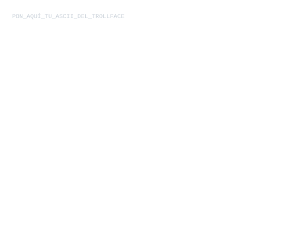

# frank-graves | `DQC Interactive`

**D**eepSeek · **Q**wen · **C**laude **Interactive**

**"I am a fucking lie, projects made full of prompts."**

*I'm an orchestrator. The AIs (DeepSeek, Qwen, Claude) write the code; I design the architecture, direct the traffic and handle quality control.*

---

### `[::]` Development Philosophy

*   **FOSS & Privacy-First:** 100% local, zero telemetry, zero cloud dependencies.
*   **Native Performance:** Strict compilation, memory control and static binaries.
*   **Prompt-Driven Architecture:** AI-assisted rapid prototyping, manual low-level refinement.

### `//` Active Projects

<!-- AUTO-UPDATE:START -->
*This section updates itself with my latest commits.*
<!-- AUTO-UPDATE:END -->

### `>>` Recent Activity

<!-- ACTIVITY-START -->
*Waiting for data from the terminal...*
<!-- ACTIVITY-END -->

---

  

<i>Built with pure code, strict rules, and zero cloud.</i>

